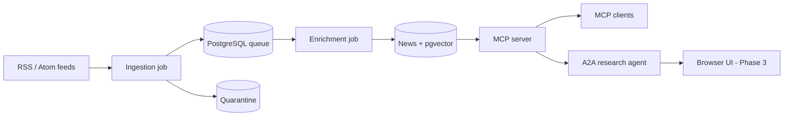
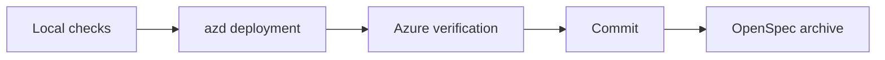

# Newsloom

Curated AI news for MCP clients, research agents, and people.

**Status: Phase 1 and Phase 2 Steps 2.1-2.2 verified; evaluation interoperability foundation verified; Step 2.3 quality baseline remains pending.**
- Available: Python workspace, 41-feed catalogue, local/CI checks, azd-managed Azure infrastructure, managed-identity migrations, RSS/Atom ingestion with real Decision-model screening, and durable queue/quarantine storage. Enrichment produces validated summaries, one of 11 categories, tags, and 1536-dimensional embeddings in PostgreSQL. The deployed MCP service provides four read-only browsing/search tools with verified Entra browser sign-in. The authenticated A2A research agent deepens or compares stored news with cited, preference-aware answers, secretless user delegation and Foundry streaming.
- The [phase acceptance matrix](docs/phase1-acceptance.md#verified-phase-acceptance-matrix) and [agent runbook](docs/agent.md) record measured acceptance, runtime provenance, preservation and passing implementation/status CI. Phase 1 and [Phase 2 Steps 2.1-2.2](docs/prd-2.md) are archived with delivered contracts in the [main specs](openspec/specs/). Frozen phase-wide evaluations, optional external web research, persistent preferences and the browser UI remain future work.
- The [evaluation foundation](docs/agent-evaluation.md#foundation-completion-ledger) verifies real DeepEval scoring, exact imported-score API/user-attested UI parity, fractional replay and disposable deletion. The two authored cases were scored once (`1.0`, `0.0`) in eight judge calls, with complete usage and estimated chat cost USD 0.004516875. Working storage, its connection and approved operator/project permissions are Terraform-owned; two unused diagnostic grants and 16 failed experiment pairs were cleaned up, with accepted reports retained. All 2,116 baseline row fingerprints were preserved, with 23 additions observed. The [scoped preservation receipt](docs/agent-evaluation.md#final-audited-preservation-acceptance) retains historical failures and excludes verified policy-managed scanning side resources without changing Defender or claiming broader effective-access preservation. Implementation, separate evidence/status and completion-ledger CI passed; the [26-task ledger](openspec/changes/archive/2026-10-30-agent-evaluation-foundation/tasks.md) retains exact-source evidence. This synthetic pilot is not the frozen deployed-agent quality baseline; its delivered contract is synchronized and the verified change is archived.
- [PRD-2's execution boundary](docs/prd-2.md#delivery-plan) requires pausing for user review after the entire phase is verified and published, before starting PRD-3.

## Architecture



## Local development

| Tool | Requirement |
| --- | --- |
| uv | 0.13.5+; downloads the pinned Python 3.15.1 runtime |
| Node.js | 20.19+; 24 LTS recommended |
| Terraform | 1.15.8+ |
| Azure CLI + azd 1.36.0+ | Required only for Azure setup and deployment |

Git and Bash are also required.

```bash
uv sync --locked --all-packages
uv sync --directory tools/agent-evaluation --locked
npm ci --no-audit --no-fund
uv run pre-commit install
bash scripts/check.sh
```

Checks need no cloud credentials or Docker daemon; the first run downloads dependencies.
Database integration tests also run in CI and can be enabled against an explicitly
started local PostgreSQL 18/pgvector instance.

Operator-only evaluation tooling has a separate Python 3.15 environment and lock
because its DeepEval dependency conflicts with the application's Click version.
Run its local checks with `bash scripts/check-agent-evaluation.sh`; see the
[evaluation runbook](docs/agent-evaluation.md) for verified compatibility and the
still-pending Azure/paid acceptance gates. Do not install its dependencies into
the application environment.

## Deploy to Azure

### 1. One-time state setup

Follow the [state-bootstrap runbook](docs/azure-bootstrap.md) for permissions,
provider registration, and azd environment inputs. Provisioning always runs
through azd, which invokes Terraform internally.

```bash
az login
az account set --subscription "<subscription-id>"
azd config set auth.useAzCliAuth true
```

After configuring the environment, **review the preview before provisioning**:

```bash
azd provision bootstrap --preview
azd provision bootstrap
```

Complete the runbook's RBAC verification before continuing. Keep the bootstrap
state; existing direct-Terraform state must be adopted before the first azd run.

### 2. Application deployment - from Step 1.1

The shared platform is provisioned and verified in the persistent development
environment. See the [delivery plan](docs/prd-1.md#delivery-plan) and follow the
[platform runbook](docs/azure-platform.md) for reviewed inputs and per-layer previews.
Select the existing environment rather than recreating it:

```bash
azd env select dev
```

Use only reviewed owning-layer preview/provision commands from the runbooks.
The active evaluation foundation adds lasting settings to the retained model
account and requires its own execution approval. Do not run an unqualified
`azd up` or `azd provision` from this checkout to apply those unreviewed changes.
See the [evaluation infrastructure boundary and rollback guidance](docs/agent-evaluation.md#owning-infrastructure-boundary).

The foundation includes verified migration and identity/model/telemetry checks.
The real ingestion job adds screened pending work, not summaries or an MCP HTTP
service. Follow the [ingestion runbook](docs/ingestion.md) for calibration,
immediate execution, independent database readback, and schedule enablement.
The separate [enrichment job](docs/enrichment.md) processes accepted work into
stored news using the existing managed identity and model deployments, with
bounded claims, atomic completion and lease recovery. The independently deployed
[MCP app](docs/mcp.md) serves committed news through Entra-protected HTTP tools.
Its owning identity/app layers reuse the existing platform and preserve both
pipeline jobs. Both runtime schedules continue in Azure independently of the
developer laptop. Follow the MCP runbook for registration, private client
configuration, isolated retrieval evaluation and operator verification.

## Useful commands

| Task | Command |
| --- | --- |
| All local checks | `bash scripts/check.sh` |
| Isolated evaluation checks, without Azure calls | `bash scripts/check-agent-evaluation.sh` |
| Python tests | `uv run pytest` |
| Validate feed configuration | `uv run newsloom-validate-feeds config/feeds.json` |
| Start Azure ingestion immediately | `uv run --locked newsloom-platform execute-ingestion` |
| Read actual ingestion database counts | `uv run --locked newsloom-platform read-ingestion` |
| Start a bounded Azure enrichment run | `uv run --locked newsloom-platform execute-enrichment --limit 10` |
| Read actual enrichment/news database counts | `uv run --locked newsloom-platform read-enrichment` |
| Verify deployed MCP workload access | `uv run --locked newsloom-platform verify-mcp` |
| Run the isolated frozen retrieval study | `uv run --locked newsloom-platform evaluate-mcp` |
| Prepare evaluation-layer inputs, metadata only | `uv run --locked newsloom-platform prepare-agent-evaluation-layer` |
| Review evaluation native plans/readback, no provisioning | `uv run --locked newsloom-platform verify-agent-evaluation --manifest <private-file>`; see the [verification procedure](docs/agent-evaluation.md#native-preview-and-preservation-verification) |
| Reconcile the blocked parent evidence, approved single-use verification only | `uv run --locked newsloom-platform reconcile-agent-evaluation --manifest <private-file>`; see [audited reconciliation](docs/agent-evaluation.md#audited-preservation-reconciliation) |
| List OpenSpec changes | `npm run spec:list` |

## Delivery workflow



See the [development guide](docs/development.md) for workflow details,
[bootstrap acceptance](openspec/changes/archive/2026-10-22-bootstrap/tasks.md) for state setup,
and [platform evidence](openspec/changes/archive/2026-10-23-platform-skeleton/tasks.md#acceptance-evidence) for Azure checks.
Delivered platform contracts are maintained in the
[platform](openspec/specs/persistent-azure-platform/spec.md),
[workload access](openspec/specs/workload-access/spec.md), and
[telemetry](openspec/specs/safe-telemetry/spec.md) main specs.
Delivered product contracts cover
[enrichment](openspec/specs/news-enrichment/spec.md),
[MCP serving](openspec/specs/mcp-serving/spec.md),
[news search](openspec/specs/news-search/spec.md), and
[phase acceptance](openspec/specs/phase1-acceptance/spec.md).
The agent's delivered contracts cover
[A2A serving](openspec/specs/a2a-serving/spec.md),
[delegated MCP access](openspec/specs/delegated-mcp-access/spec.md), and
[stored-news research](openspec/specs/news-research/spec.md).

## Documentation

| Topic | Links |
| --- | --- |
| Phase 1: MCP platform | [PRD](docs/prd-1.md) / [Capabilities](docs/prd-1-capabilities.md) |
| Phase 2: Research agent | [PRD](docs/prd-2.md) / [Capabilities](docs/prd-2-capabilities.md) |
| Phase 3: Browser UI | [PRD](docs/prd-3.md) / [Capabilities](docs/prd-3-capabilities.md) |
| Architecture and operations | [ADRs](docs/adrs.md) / [Platform notes](docs/platform-notes.md) |
| Azure platform deployment | [Platform runbook](docs/azure-platform.md) |
| Feed ingestion and real screening | [Ingestion runbook](docs/ingestion.md) |
| Structured news enrichment and embeddings | [Enrichment runbook](docs/enrichment.md) |
| Authenticated MCP browsing/search | [MCP runbook](docs/mcp.md) |
| A2A agent and stored-news research | [Agent runbook](docs/agent.md) |
| Synthetic evaluation foundation and Azure gates | [Evaluation runbook](docs/agent-evaluation.md) |
| AI contributor instructions | [AGENTS.md](AGENTS.md) |
