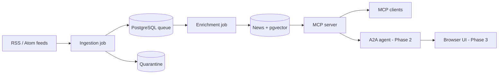
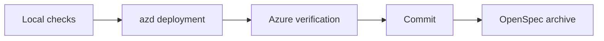

# Newsloom

Curated AI news for MCP clients, research agents, and people.

**Status: shared Azure foundation implemented and verified.**
- Available: Python workspace, 42-feed catalogue, local/CI checks, azd-managed Azure infrastructure, and managed-identity database migrations.
- Planned: scheduled ingestion/enrichment, the MCP HTTP service, research agent, and browser UI. The foundation does not complete PRD-1.

## Planned architecture



## Local development

| Tool | Requirement |
| --- | --- |
| uv | 0.13.5+; downloads the pinned Python 3.15.1 runtime |
| Node.js | 20.19+; 24 LTS recommended |
| Terraform | 1.15.8+ |
| Azure CLI + azd 1.36.0+ | Required only for Azure setup and deployment |

Git and Bash are also required.

```bash
uv sync --locked --all-packages
npm ci --no-audit --no-fund
uv run pre-commit install
bash scripts/check.sh
```

Checks need no cloud credentials or Docker daemon; the first run downloads dependencies.
Database integration tests also run in CI and can be enabled against an explicitly
started local PostgreSQL 18/pgvector instance.

## Deploy to Azure

### 1. One-time state setup

Follow the [state-bootstrap runbook](docs/azure-bootstrap.md) for permissions,
provider registration, and azd environment inputs. Provisioning always runs
through azd, which invokes Terraform internally.

```bash
az login
az account set --subscription "<subscription-id>"
azd config set auth.useAzCliAuth true
```

After configuring the environment, **review the preview before provisioning**:

```bash
azd provision bootstrap --preview
azd provision bootstrap
```

Complete the runbook's RBAC verification before continuing. Keep the bootstrap
state; existing direct-Terraform state must be adopted before the first azd run.

### 2. Application deployment - from Step 1.1

The shared platform is provisioned and verified in the persistent development
environment. See the [delivery plan](docs/prd-1.md#delivery-plan) and follow the
[platform runbook](docs/azure-platform.md) for reviewed inputs and per-layer previews.
Deploy incremental changes into the existing environment:

```bash
azd env select dev
azd up
```

The foundation includes verified migration and identity/model/telemetry checks,
not scheduled ingestion/enrichment or an MCP HTTP service.
The bootstrap, application, and migrations layers run in order in the same environment.

## Useful commands

| Task | Command |
| --- | --- |
| All local checks | `bash scripts/check.sh` |
| Python tests | `uv run pytest` |
| Validate feed configuration | `uv run newsloom-validate-feeds config/feeds.json` |
| List OpenSpec changes | `npm run spec:list` |

## Delivery workflow



See the [development guide](docs/development.md) for workflow details,
[bootstrap acceptance](openspec/changes/archive/2026-10-22-bootstrap/tasks.md) for state setup,
and [platform evidence](openspec/changes/archive/2026-10-23-platform-skeleton/tasks.md#acceptance-evidence) for Azure checks.
Delivered platform contracts are maintained in the
[platform](openspec/specs/persistent-azure-platform/spec.md),
[workload access](openspec/specs/workload-access/spec.md), and
[telemetry](openspec/specs/safe-telemetry/spec.md) main specs.

## Documentation

| Topic | Links |
| --- | --- |
| Phase 1: MCP platform | [PRD](docs/prd-1.md) / [Capabilities](docs/prd-1-capabilities.md) |
| Phase 2: Research agent | [PRD](docs/prd-2.md) / [Capabilities](docs/prd-2-capabilities.md) |
| Phase 3: Browser UI | [PRD](docs/prd-3.md) / [Capabilities](docs/prd-3-capabilities.md) |
| Architecture and operations | [ADRs](docs/adrs.md) / [Platform notes](docs/platform-notes.md) |
| Azure platform deployment | [Platform runbook](docs/azure-platform.md) |
| AI contributor instructions | [AGENTS.md](AGENTS.md) |
