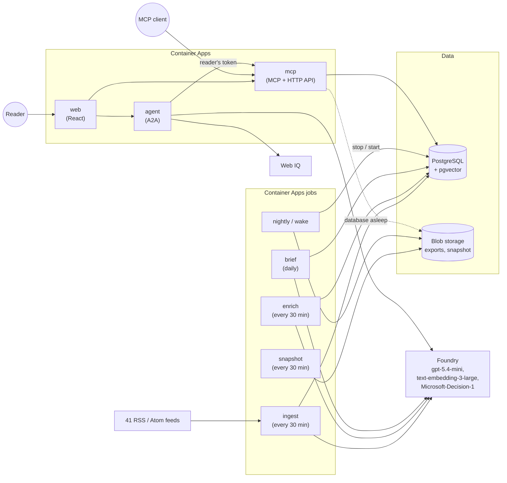
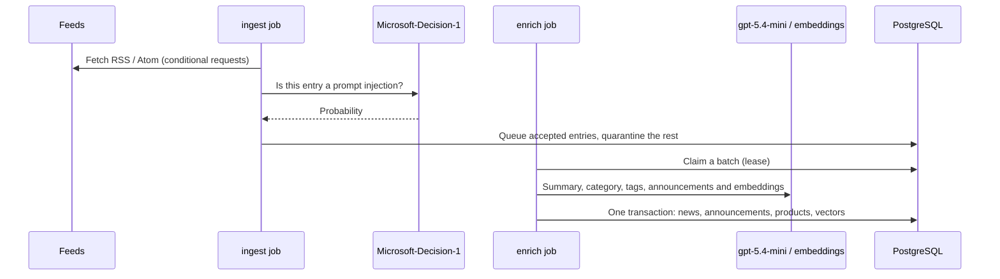
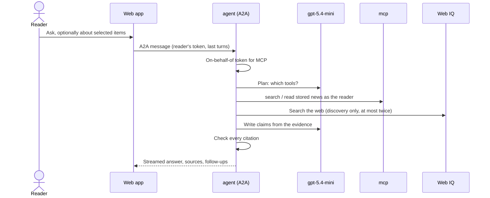
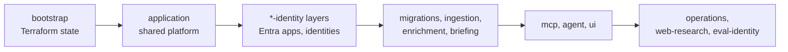

<div align="center">

# Newsloom

**AI news that tells architects what to act on: 41 feeds screened, summarised and linked to products, served to people, to Copilot over MCP and to a research agent over A2A 1.0, all as the signed-in user.**

[](https://github.com/ikhemissi/newsloom/actions/workflows/checks.yml)
[](infra)
[](azure.yaml)
[](pyproject.toml)
[](services/mcp)
[](services/agent)

[**Quick start**](#quick-start) · [**What it shows**](#what-it-shows) · [**Architecture**](#architecture) · [**Who acts on each call**](#who-acts-on-each-call) · [**Costs**](#costs) · [**Production considerations**](#production-considerations) · [**Documentation**](#documentation)

</div>

Newsloom reads 41 AI news feeds every half hour, screens them for prompt injection,
summarises and links each announcement to the products it concerns, and serves the
result three ways: a web app with a personal radar and a daily briefing, an MCP
server for GitHub Copilot and other MCP clients, and a research agent that answers
questions with cited sources from stored news and the web.

It runs in one Azure resource group, signs everyone in with Microsoft Entra ID, uses
managed identities everywhere and holds no secrets.


## Why it matters

| For… | Newsloom… | So that… |
|---|---|---|
| **AI solution architects** | ranks announcements into *act now*, *worth knowing* and *can wait* for the products they follow, with a daily five-minute briefing | they see the changes that affect their work without reading every blog |
| **Researchers** | answers questions over stored news and, when needed, the web, citing every claim and keeping the conversation | answers can be checked, and follow-ups stay on topic |
| **Copilot users** | exposes the news through read-only MCP tools with Entra sign-in | news is available in the editor and in other agents |
| **Operators** | backs up the data daily, stops the database at night, serves a read-only copy meanwhile and runs live evals in CI | the service is cheap to run, recoverable and measured |
| **Architects reusing the code** | wires Foundry models, Container Apps, PostgreSQL/pgvector, A2A, MCP and Entra on-behalf-of end to end, specified with OpenSpec | they start from working patterns |

### AI you can trust

- **Untrusted input stays data.** Every feed entry is screened by `Microsoft-Decision-1`
  for prompt injection before any language model sees it; rejected entries go to
  quarantine. Web results are untrusted data too: never instructions, always cited
  separately.
- **Every claim is cited.** Answers cite stored items as `[1]` and web results as `[W1]`,
  in separate sections; citations are checked in code before the answer is returned.
- **The agent acts as the reader, read-only.** It calls the MCP tools with the
  signed-in user's token (on-behalf-of, no secret) and cannot change anything.
- **Nothing sensitive in logs.** Telemetry carries counts and categories, never
  article text, prompts, answers or tokens.
- **Quality is measured.** Recorded replays and live model evals run in CI; reader
  ratings become evaluation cases.

## What it shows

| # | Capability | Highlights | Runbook |
|---|---|---|---|
| 1 | Feed ingestion | 41 RSS/Atom feeds every 30 min, idempotent, `Microsoft-Decision-1` screening, quarantine | [ingestion](docs/ingestion.md) |
| 2 | Enrichment | `gpt-5.4-mini` summaries, one of 11 categories and tags; full article text where allowed; announcements linked to products and vendors; `text-embedding-3-large` (1,536 dimensions) in pgvector | [enrichment](docs/enrichment.md) |
| 3 | MCP server | `search_news`, `get_recent_news`, `get_news_item`, `list_sources`; Entra sign-in from VS Code | [MCP](docs/mcp.md) |
| 4 | Architect radar | Home page: what needs action, what is worth knowing and what can wait, personalised by followed products | [UI](docs/ui.md) |
| 5 | News browsing | News list, search, source/category/date filters, shareable item pages, product pages | [news API](docs/news-api.md), [UI](docs/ui.md) |
| 6 | Daily briefing | A shared overview of the last seven days every morning, TL;DR first, every statement cited | [briefing](docs/briefing.md) |
| 7 | Research agent | A2A agent on Microsoft Agent Framework: conversations with suggested follow-ups, web research through Web IQ | [agent](docs/agent.md) |
| 8 | Reader feedback | Ratings and comments on briefings and answers, reviewed and turned into eval cases | [UI](docs/ui.md#reader-feedback) |
| 9 | Nightly operations | Daily export to immutable storage, database stopped 23:00–07:00 UTC, read-only snapshot refreshed every 30 min | [operations](docs/operations.md) |
| 10 | Evaluations | Replay and live evals in CI; Foundry-published agent evaluations | [development](docs/development.md#live-evals-in-ci), [evaluation](docs/agent-evaluation.md) |

## Architecture



| Layer | Technology |
|---|---|
| Services and jobs | Python 3.15, Starlette, MCP Python SDK, psycopg 3 |
| Research agent | Microsoft Agent Framework, A2A SDK, Foundry `gpt-5.4-mini`, Web IQ |
| Web app | React 19, Vite, MSAL, served from Container Apps |
| Data | Azure Database for PostgreSQL flexible server 18 with pgvector; Blob storage |
| Models | Foundry: `gpt-5.4-mini` and `Microsoft-Decision-1` (EU data zone), `text-embedding-3-large` |
| Infrastructure | Terraform in independent layers, deployed with azd |
| Observability | OpenTelemetry → Application Insights |
| Region | `francecentral` |

Design decisions are in the [ADRs](docs/adrs.md); operational lessons are in the
[platform notes](docs/platform-notes.md).

### Who acts on each call

| Call | Credential | What the callee sees |
|---|---|---|
| Web app → news API (`mcp`) | The reader's Entra token, delegated `news.read` | The reader |
| VS Code / Copilot → MCP tools | The reader's token from a public PKCE client | The reader |
| Web app → agent (A2A) | The reader's token for the agent's API | The reader |
| Agent → MCP tools | An on-behalf-of token, exchanged with a federated credential of the agent's managed identity (no secret) | The reader |
| Agent → Foundry model, Web IQ | The agent's managed identity | The agent |
| `mcp` → PostgreSQL, embeddings, snapshot blob | The MCP managed identity (read-only database role) | The MCP service |
| Jobs → PostgreSQL, Foundry, feeds, Blob storage | One managed identity per job | That job |
| CI → Foundry (live evals) | GitHub OIDC federated to a chat-completions-only identity | The CI eval identity |

The agent has no data access of its own: without the reader's token it can read
nothing, and it never writes.

## How it works

### 1. From feeds to stored news



- **Idempotent and recoverable:** entries are keyed by source and ID; expired leases are
  reclaimed, and a news item is written in one transaction or not at all.
- **Announcements, not just articles:** each item is split into announcements linked
  to products and vendors, which feed the radar and product pages.

### 2. Research agent



- **Bounded:** at most 10 evidence items per answer, shared between stored news and
  the web; selected-item questions use stored news only.
- **Conversations** live in the browser; the agent stores nothing between requests.

### 3. The daily rhythm

All times are UTC (Paris is one hour later in winter).

| Time | What happens |
|---|---|
| 07:00 | `wake` starts PostgreSQL and repairs governance tags |
| 07:10–22:40, every 30 min | `ingest` and `enrich` |
| 07:15–22:45, every 30 min | `snapshot` refreshes the read-only copy |
| 07:45 | `brief` writes the daily briefing |
| 23:00 | `nightly` exports the database to immutable storage, then stops PostgreSQL |

While PostgreSQL is stopped or unreachable, the API serves the latest snapshot
read-only: the radar, briefing, news and item pages keep working, and search,
research and feedback are hidden.

## Security

| Principle | How |
|---|---|
| Passwordless | Managed identities and Entra ID everywhere; PostgreSQL, Storage and Foundry use Entra authentication only |
| No secrets | Nothing in code, configuration, IaC outputs or CI; CI signs in with GitHub OIDC federation |
| User access | Single-tenant Entra sign-in; MCP and the agent check their own scopes |
| Delegation | The agent calls MCP on behalf of the reader with a federated credential, never with its own data access |
| Least privilege | One identity per workload, data-plane roles only; the CI eval identity may only call chat completions |
| Untrusted content | Screening before models, strict output schemas, citation checks, no content in logs |

## Design notes

- **Screen before any model reads.** Feed text can carry instructions; `Microsoft-Decision-1`
  answers one closed question (is this a prompt injection?) before enrichment, and
  every later model call treats news and web text as data inside strict schemas.
- **Code checks what models write.** Summaries, briefings and answers are validated
  against typed schemas; citations must point to evidence the agent actually read.
- **Announcements are the unit.** Articles are split into announcements linked to
  products and vendors, so the radar can rank what changed for the products a
  reader follows rather than whole articles.
- **Cheap by default.** The database sleeps at night and the API serves a snapshot
  meanwhile; the apps run one small replica each; jobs run only on schedule.
- **Layered infrastructure.** Each capability owns its Terraform layer, identity and
  grants, previewed and applied separately, so changing one part cannot touch another.

## What runs where

| Path | Content |
|---|---|
| `services/ingestion`, `services/enrichment`, `services/briefing` | Pipeline jobs |
| `services/mcp` | MCP server, HTTP news API and the read snapshot |
| `services/agent` | A2A research agent |
| `services/web` | Web app (npm workspace) |
| `services/operations` | Nightly export, stop, wake and restore drill |
| `services/platform` | `newsloom-platform` operator CLI: builds, layer preparation, verification |
| `packages/newsloom-core` | Shared models, categories and model transport |
| `tools/agent-evaluation` | Operator evaluation tooling (separate environment) |
| `infra/` | Terraform layers deployed by azd ([`azure.yaml`](azure.yaml)) |
| `config/` | Feed catalogue |
| `scripts/` | Checks, evals, previews and helpers |
| `docs/` | PRDs, ADRs and runbooks |
| `openspec/` | Specifications and change history |

## Quick start

### 1. Prerequisites

- Owner, or Contributor and User Access Administrator, on the subscription; permission
  to create Entra app registrations.
- Azure CLI, azd 1.36+, Terraform 1.15.8+, uv 0.13.5+, Node.js 24+, Git and Bash.
  Images are built in Azure Container Registry; no local container engine is needed.

### 2. Deploy to Azure

Newsloom is deployed layer by layer, each with a reviewed preview; there is no single
`azd up`. Start with the [state bootstrap](docs/azure-bootstrap.md), then follow the
[platform runbook](docs/azure-platform.md) and each capability's runbook.

```bash
az login
azd config set auth.useAzCliAuth true
azd env new dev --location francecentral
azd provision bootstrap --preview   # review, then run without --preview
```



For every layer: `azd provision <layer> --preview`, review the plan, then
`azd provision <layer>`. Never run an unqualified `azd provision` or `azd up`.

### 3. Manual step: Web IQ access for the agent

Web research needs one step that cannot be automated yet: Web IQ client-ID
bindings have no Azure Resource Manager API, so Terraform cannot create them.
After `azd provision web-research` has created the `webiq-newsloom-<env>`
account:

1. Open [Web IQ profiles](https://webiq.microsoft.ai/profiles) with an account
   that can manage the subscription and connect the `webiq-newsloom-<env>` account.
2. On **Application (Client) IDs**, bind the agent identity's client ID
   (`azd env get-value AGENT_IDENTITY_BASE64 | base64 -d`, field `client_id`).

No API key is needed. Until this is done Web IQ answers 401 and research works
without the web. See the [agent runbook](docs/agent.md#web-iq-account-and-managed-identity-access);
remove this step if Web IQ adds an API for bindings.

### 4. Settings

Set with `azd env set <name> <value>`, then preview and provision the owning layer:

| Setting | Effect |
|---|---|
| `RESOURCE_TAGS` | Extra tags on every resource, e.g. `owner=team-a,costCenter=42` (for tags your tenant's policies require) |
| `INGESTION_SCHEDULE_ENABLED` / `ENRICHMENT_SCHEDULE_ENABLED` / `BRIEFING_SCHEDULE_ENABLED` | `false` keeps a job manual |
| `ENRICHMENT_MODEL`, `ENRICHMENT_SKU`, `ENRICHMENT_CAPACITY` (and `EMBEDDINGS_*`, `SCREENING_*`) | Model deployments |
| `SCANNER_THRESHOLD` / `SCANNER_CALIBRATION_ID` | Screening threshold and the calibration it came from |
| `POSTGRES_SKU` / `POSTGRES_STORAGE_MB` / `POSTGRES_BACKUP_DAYS` | Database size and backups |
| `WEB_RESEARCH_ENABLED` | `true` creates the Web IQ account and lets the agent search the web |
| `EVAL_IDENTITY_ENABLED` | `true` creates the CI eval identity ([live evals](docs/development.md#live-evals-in-ci)) |
| `LOG_DAILY_CAP_GB` / `LOG_RETENTION_DAYS` | Log Analytics cap and retention |

## Tech stack

Versions used in November 2026:

| Technology | Role | Version |
|---|---|---|
| Microsoft Foundry | Enrichment, briefing and agent model; embeddings; screening | `gpt-5.4-mini`, `text-embedding-3-large`, `Microsoft-Decision-1` |
| [Microsoft Agent Framework](https://github.com/microsoft/agent-framework) | The research agent | core 1.23, A2A 1.0.0b261022 |
| [A2A](https://a2a-protocol.org) | Web app → agent | 1.0 (a2a-sdk 1.2) |
| [MCP Python SDK](https://github.com/modelcontextprotocol/python-sdk) | The MCP server | 2.3 |
| Web IQ | Web search for the agent | v3 API |
| [React](https://react.dev), [Vite](https://vite.dev), [MSAL](https://github.com/AzureAD/microsoft-authentication-library-for-js) | The web app | 19.3, 8.3, 5.27 |
| Python, [uv](https://docs.astral.sh/uv/), Starlette, psycopg | Services and jobs | 3.15, 0.13, 1.9, 3 |
| Azure Container Apps, PostgreSQL flexible server, Blob storage, Container Registry | Apps and jobs, data with pgvector, exports and snapshot, images | PostgreSQL 18 |
| OpenTelemetry, Application Insights | Telemetry | |
| [Terraform](https://www.terraform.io), [azd](https://learn.microsoft.com/azure/developer/azure-developer-cli/) | Infrastructure and deployment | 1.15.8+, 1.36+ |

## Build and test

```bash
uv sync --locked --all-packages
uv sync --directory tools/agent-evaluation --locked   # evaluation tooling, separate environment
npm ci --no-audit --no-fund
npx playwright install chromium
uv run pre-commit install
bash scripts/check.sh
```

| Part | Command |
|---|---|
| Everything affected by your change | `bash scripts/check.sh` (`--all` for everything) |
| Python tests / types | `uv run pytest` / `uv run mypy` |
| Web app | `npm run -w services/web dev`; see the [UI runbook](docs/ui.md#local-development) |
| Evals | `bash scripts/eval.sh` (recorded replays, $0); `--live` adds real model calls (about $0.015) |
| Model-driven previews | `scripts/research-preview.sh`, `scripts/briefing-preview.sh`, `scripts/triage-preview.sh` |
| Evaluation tooling | `bash scripts/check-agent-evaluation.sh`; its DeepEval dependency conflicts with the application, so never install it into the main environment |
| Specs | `npm run spec:check` |

Checks need no cloud access. Database tests run in CI and locally against PostgreSQL 18
with pgvector (with Podman: set `DOCKER_HOST` to the Podman socket).

## Continuous integration

Every pull request and push to `main` runs [`checks.yml`](.github/workflows/checks.yml):

| Job | Checks |
|---|---|
| `checks` | Lint, types, tests (with PostgreSQL), web build and browser tests, Terraform tests, OpenSpec validation; only what the change affects on draft PRs, everything on ready PRs and `main` |
| `evals` | On ready PRs and `main`: recorded replays, then live evals signed in through OIDC as a chat-only identity; a failure blocks the merge |

`main` is protected: changes land as squash-merged pull requests with green checks.

## Operate

| Command | Purpose |
|---|---|
| `uv run newsloom-platform execute-ingestion` / `execute-enrichment --limit 10` | Run a job now |
| `uv run newsloom-platform read-ingestion` / `read-enrichment` | Database counts |
| `uv run newsloom-platform verify-mcp` / `verify-agent` / `verify-ui` | Verify a deployed workload |
| `uv run newsloom-platform unblock-state` | Restore tags and access on the Terraform state storage |
| `bash scripts/restore-drill.sh` | Restore the latest export into a scratch database |

Telemetry goes to Application Insights; see the [operations runbook](docs/operations.md)
for the nightly jobs, backups and restore.

## Documentation

| Document | Purpose |
|---|---|
| [PRD-1](docs/prd-1.md), [PRD-2](docs/prd-2.md), [PRD-3](docs/prd-3.md) | Phases, status and delivery plan (MCP platform, research agent, web app) |
| [Capabilities 1](docs/prd-1-capabilities.md), [2](docs/prd-2-capabilities.md), [3](docs/prd-3-capabilities.md) | Behaviour and acceptance criteria |
| [ADRs](docs/adrs.md) | Architecture decisions |
| [openspec/specs](openspec/specs) | Delivered specifications; [active changes](openspec/changes) |
| [Development guide](docs/development.md) | Workflow, delivery tracks, CI and evals |
| [Known gaps](docs/known-gaps.md) | Checks that could not run yet |
| Runbooks | [Bootstrap](docs/azure-bootstrap.md) · [Platform](docs/azure-platform.md) · [Ingestion](docs/ingestion.md) · [Enrichment](docs/enrichment.md) · [MCP](docs/mcp.md) · [News API](docs/news-api.md) · [Briefing](docs/briefing.md) · [Agent](docs/agent.md) · [UI](docs/ui.md) · [Operations](docs/operations.md) · [Evaluation](docs/agent-evaluation.md) |

## Costs

The `dev` environment cost **about $4.00 a day, or $121 a month**, from 8 to 14
November 2026 (Cost Management, actual cost, USD, `francecentral`), with the feeds
processed every 30 minutes and the database stopped at night.

| Service | Per day | Per month (×30.4) | What drives it |
|---|---:|---:|---|
| Foundry models | $0.94 | $29 | Tokens: enrichment of every new item, the daily briefing, research questions and evals |
| Container Apps | $0.62 | $19 | `mcp`, `agent` and `web`, one 0.25 vCPU replica each, always on; jobs per run |
| PostgreSQL, Burstable B1ms, 32 GiB | $0.48 | $15 | Compute only while running (07:00–23:00 UTC); storage always |
| Container Registry, Basic | $0.21 | $6 | Always on |
| Log Analytics, Storage, Web IQ, bandwidth | $0.05 | $1 | Volume; Log Analytics has a daily cap |
| **Newsloom** | **$2.30** | **$70** | |
| Defender for Cloud | $1.69 | $51 | A subscription plan, billed per resource |
| **Total** | **$3.99** | **$121** | |

A live eval run in CI costs about $0.015; a scheduled enrichment run takes about
30 seconds.

## Clean up

The data layers are protected on purpose: Terraform `prevent_destroy` on the
database, model account, identities and state, and delete locks on the backup
storage. Removing an environment is a deliberate operation: lift the locks, then
destroy layer by layer in reverse order (see the
[platform runbook](docs/azure-platform.md)). Do not run `azd down` on a shared
environment.

## Versions and preview notes

As of November 2026:

- The agent uses `agent-framework-a2a` 1.0.0b261022, a pre-release package.
- The Web IQ client-ID binding is a manual step ([Quick start](#3-manual-step-web-iq-access-for-the-agent)).
- Container Apps cron is UTC, so the daily schedule moves by one hour in Paris in summer.
- `gpt-5.4-mini` and `Microsoft-Decision-1` use Data Zone Standard (EU data zone); the
  embeddings use a regional Standard deployment.

## Production considerations

This is one development environment, tuned for low cost. Review at least the following
before production use:

| Area | Recommendation | Why |
|---|---|---|
| Network | Private endpoints for PostgreSQL, Storage and Foundry; Container Apps in a VNet | Endpoints are public, protected by Entra ID |
| Resilience | General Purpose PostgreSQL with zone-redundant HA, no nightly stop; geo-redundant exports | Burstable server without HA, stopped at night |
| Environments | Separate dev/test/prod; deploy from CI with workload identity federation | One environment deployed from a workstation |
| Schedules | Time-zone-aware scheduling | Container Apps cron is UTC only |
| Dependencies | Act on Dependabot alerts; add a vulnerability gate to CI | CI does not scan dependencies yet |
| Monitoring | Alert rules on job failures, API errors and model throttling | Telemetry exists, alert rules do not |
| AI | Re-run the frozen agent baseline after each model or prompt change; watch model deprecations | The baseline run is still pending ([agent-quality-baseline](openspec/changes/agent-quality-baseline/tasks.md)) |

## Contributing

- **Spec-driven:** new capabilities, resources, identities, permissions, dependencies and
  data contracts are [OpenSpec](https://github.com/Fission-AI/OpenSpec) changes
  (propose → apply → archive); other changes are a pull request with a runbook update.
  See the [delivery tracks](docs/development.md#choose-a-delivery-track).
- **Coding agents** follow [AGENTS.md](AGENTS.md).
