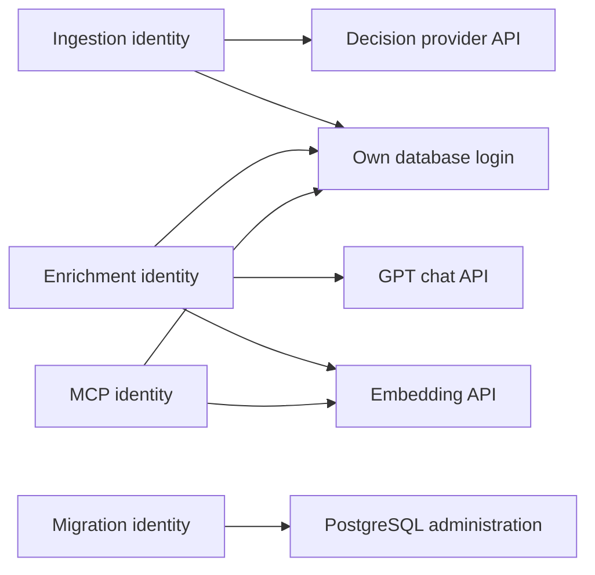

# Azure platform operations

The shared foundation is provisioned, with database, model, identity, and
telemetry checks verified in Azure. See the
[acceptance evidence](../openspec/changes/platform-skeleton/tasks.md#acceptance-evidence)
for deployment, convergence, and CI results. Follow the
[state runbook](azure-bootstrap.md) first. Reuse `dev` and its existing state:
never recover a failed deployment with `azd down`.

## Application deployment

The application layer owns `rg-newsloom-dev`, not the state group. Resource names
are stable; globally unique names include a deterministic environment/subscription
suffix. Common tags pass from azd inputs into Terraform's `tags` variable.

```bash
azd env select dev
bash scripts/check.sh
azd provision application --preview
azd provision application
```

Review the preview before provisioning. Stop for resource replacement/deletion,
unavailable capacity, unexpected costs, or permission errors. Do not change
`AZURE_LOCATION` automatically: the bootstrap resources also use that setting.

PostgreSQL child operations are serialized because Azure rejects concurrent
server mutations. Azure selects the server's availability zone; Terraform
preserves that placement rather than trying to clear it on every deployment.
The non-VNet ACA environment leaves infrastructure resource-group naming to
Azure instead of requesting a name the service does not retain.

### Reviewed development settings

All values are set with `azd env set NAME VALUE` in the ignored environment.
The following values were selected for this persistent environment, not mandated
for every tenant or future environment.

| Input | Selected value |
| --- | --- |
| `APPLICATION_RESOURCE_GROUP` | `rg-newsloom-dev` |
| `POSTGRES_SKU` / `POSTGRES_STORAGE_MB` | `B_Standard_B1ms` / `32768` |
| `POSTGRES_BACKUP_DAYS` | `7` |
| `LOG_RETENTION_DAYS` / `LOG_DAILY_CAP_GB` | `30` / `0.1` |
| `ENRICHMENT_DEPLOYMENT` / `ENRICHMENT_MODEL` | `newsloom-enrichment` / `gpt-5.4-mini` |
| `ENRICHMENT_VERSION` / `ENRICHMENT_FORMAT` | `2026-03-17` / `OpenAI` |
| `ENRICHMENT_SKU` / `ENRICHMENT_CAPACITY` | `DataZoneStandard` / `10` |
| `EMBEDDINGS_DEPLOYMENT` / `EMBEDDINGS_MODEL` | `newsloom-embeddings` / `text-embedding-3-large` |
| `EMBEDDINGS_VERSION` / `EMBEDDINGS_FORMAT` | `1` / `OpenAI` |
| `EMBEDDINGS_SKU` / `EMBEDDINGS_CAPACITY` | `Standard` / `10` |
| `SCREENING_DEPLOYMENT` / `SCREENING_MODEL` | `newsloom-screening` / `Microsoft-Decision-1` |
| `SCREENING_VERSION` / `SCREENING_FORMAT` | `1` / `Microsoft` |
| `SCREENING_SKU` / `SCREENING_CAPACITY` | `DataZoneStandard` / `60` |

Refresh the catalog, subscription quota, PostgreSQL restrictions, and prices before
changing settings. Capacity units are model/SKU-specific. No deployment uses
provisioned throughput or automatic model upgrades. The Decision model's advertised
retirement is **2027-02-04**; replacement requires the separate ADR-6 decision.

The reviewed incremental fixed-cost estimate is about **USD 23.20/month** for
730 hours of B1MS, 32 GiB storage, and ACR Basic, before tax/discounts. Consumption
jobs, image builds, model tokens, logs, transfer, and excess storage add usage
charges. A daily log cap may interrupt diagnostics and is not a hard budget.
See the [change evidence](../openspec/changes/platform-skeleton/tasks.md#acceptance-evidence)
for the dated API readings and outstanding acceptance checks.

## Outputs and workload boundaries

Inspect outputs with `azd env get-values`; do not paste the complete output into
logs or tickets. It contains tenant-specific identifiers and telemetry routing
configuration even though it contains no application passwords.

| Output | Meaning |
| --- | --- |
| `AZURE_RESOURCE_GROUP` | Actual application group |
| `AZURE_CONTAINER_REGISTRY_NAME` / `AZURE_CONTAINER_REGISTRY_ENDPOINT` | Image build/pull target |
| `AZURE_CONTAINER_APPS_ENVIRONMENT_ID` | Shared Consumption environment |
| `POSTGRES_HOST` / `POSTGRES_DATABASE` | Encrypted Entra-only database target |
| `POSTGRES_ADMIN_NAME` / `WORKLOAD_IDENTITIES` | Migration administrator and distinct workload identities |
| `WORKLOAD_IDENTITIES_BASE64` | The same JSON encoded for quote-safe azd migration inputs; not encryption |
| `MODEL_ENDPOINT` / deployment inputs above | Pinned model targets |
| `APPLICATIONINSIGHTS_ID` / `APPLICATIONINSIGHTS_CONNECTION_STRING` | Authenticated telemetry routing, not a key-based fallback |
| `LOG_ANALYTICS_WORKSPACE_ID` | Log query target |
| `WORKLOAD_GRANTS` | Principal/scope/action inventory to verify against actual access |

The model endpoint uses the account's configured custom subdomain and the
service-advertised `services.ai.azure.com` Foundry route. The generic Cognitive
Services endpoint exported by AzureRM does not identify that provider route.



Runtime identities receive ACR pull and scoped telemetry publishing. Their custom
inference roles contain only the specified API operations at the AIServices
account scope; they do **not** assert deployment-level RBAC. Account-wide OpenAI
User or Cognitive Services User roles are not substitutes. Actual allowed and
denied calls, including alternate API routes, must pass before acceptance.
Migration receives registry pull and database administration, not model inference,
registry push, or runtime telemetry publishing.

PostgreSQL allows the explicit Azure-services firewall exception, not an
unrestricted Internet address range. Clients must use Entra tokens and verified
TLS. Schema and principal changes belong to the migration job, not application
startup or a developer's SQL shell. Domain tables and their grants remain pending.

## Migration image and initialization

The `migrations` layer owns the real manual initialization job and its separate
state blob, `newsloom/<environment>-migrations.tfstate`. Its build hook reuses or
builds the source/lock-derived image in ACR and supplies an immutable digest.
The build resolves the repository root, including when azd invokes its hook
from the migration layer directory.
The postprovision hook starts the job and waits for its actual terminal status.
Build, image-pull, SQL, or job failures fail the operation.

After the application layer exists:

```bash
azd hooks run preprovision --layer migrations
azd provision migrations --preview
azd provision migrations
```

The principal phase runs in the `postgres` maintenance database, where Azure's
Entra mapping functions live. A session advisory lock spans both database phases.
The application phase installs pgvector and revokes public schema/database
privileges. Each phase has a transactional, checksum-checked administrative ledger.
A later phase failure does not undo a previously committed phase; fix forward and
rerun. Changed/mismatched mappings fail instead of silently remapping identities.
No directory-name resolution or Graph permissions are required.

## Real Azure verification and cleanup

Enable the four specifically named, temporary verification jobs, deploy them
through azd, and run Newsloom's smoke command:

```bash
azd env set PLATFORM_VERIFICATION_ENABLED true
azd provision migrations --preview
azd provision migrations
uv run --locked newsloom-platform verify
```

Each job attaches only its own identity and pulls the actual platform image.
Checks cover database/vector readiness and denied privileges, the configured
model contracts and forbidden inference/management operations, registry pull
without push, authenticated telemetry, and rejected unauthenticated telemetry.
The observed Decision response stores its finite 0-1 probability in
`answers.ready.noul`, with `answers.ready.type` equal to `noul`; the verifier
does not substitute a guessed `probability` field.
The operator verifies correlated events and content/credential canary exclusion
in Log Analytics. Synthetic checks do not calibrate the scanner or process news.

`PLATFORM_LAST_PROBE_RUN_ID`, `PLATFORM_LAST_VERIFICATION_EXECUTIONS`, and
`MIGRATION_LAST_EXECUTION` retain safe correlation/execution references in the
ignored environment. Failures report a safe category and execution reference,
never raw service bodies. Inspect the explicitly identified execution in Azure;
do not enable HTTP body/token logging for diagnosis.

After successful verification:

```bash
azd env set PLATFORM_VERIFICATION_ENABLED false
azd provision migrations --preview
azd provision migrations
azd up
```

The cleanup preview must remove **only** the four jobs listed in the previous
`PLATFORM_VERIFICATION_JOBS` output. It must retain the migration job and every
shared resource. No wildcard or direct CLI resource deletion is used. Re-enable
the flag and reprovision this layer before rerunning the verification command.

## Local database tests

Start a disposable PostgreSQL 18/pgvector container bound only to loopback with
local trust authentication. Point tests at its maintenance database:

```bash
NEWSLOOM_TEST_POSTGRES_DSN="host=127.0.0.1 port=15432 user=postgres dbname=postgres" \
  uv run --locked pytest tests/test_platform_database.py
```

Tests reject non-loopback targets. They cover replay, serialization, rollback,
principal mismatches, and the real vector SQL. Their local Entra-function stand-ins
test migration SQL, not Entra authentication; only the Azure jobs establish that.
CI supplies its own disposable PG18/pgvector service. Without the explicit DSN,
these four integration tests are skipped; the remaining local gate stays offline.

## Recovery and honest readiness

- Keep the state, database, registry, and environment after partial failure.
- Fix the reported configuration or permission issue, review another azd preview,
  and retry through azd. Never enable passwords/keys as a workaround.
- Do not expose tokens, article content, prompts, model responses, connection
  strings, or arbitrary upstream error bodies in job output.
- Resource provisioning alone does not prove migrations, model permissions, or
  telemetry. Record real Azure execution/query evidence before accepting the change.
- This foundation does not deploy scheduled ingestion/enrichment or an MCP HTTP
  service. Their delivery follows [PRD-1's ordered slices](prd-1.md#delivery-plan).
